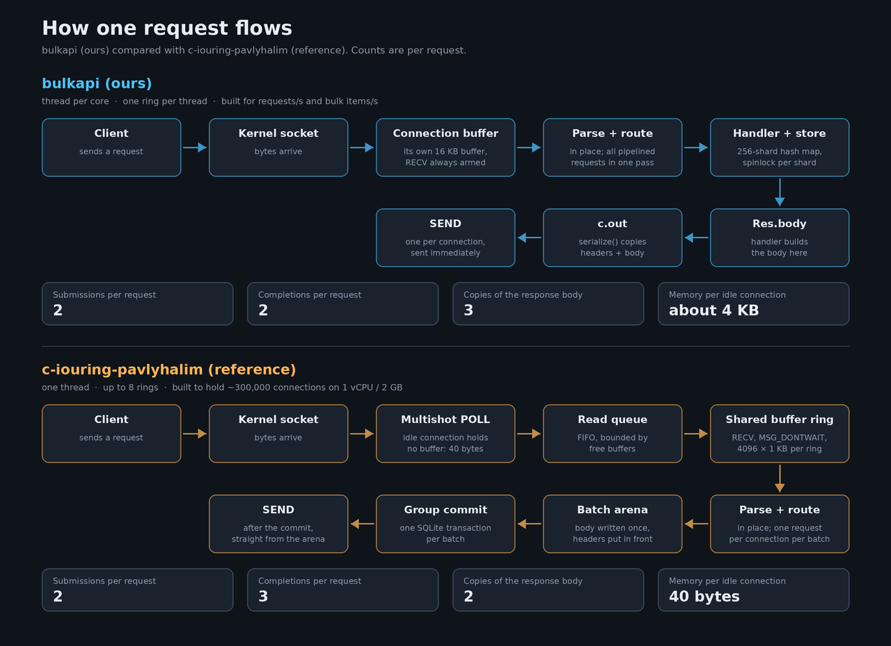

# bulkapi vs c-iouring-pavlyhalim (twelve-dollar-server-challenge PR #245)

Reference: `reference/c-iouring-pavlyhalim/` at merged commit `6a1eab9` (read-only copy, unmodified).
Files that matter: `src/server.c` (event loop), `src/sys.h` (raw io_uring ABI), `src/http.h` (parser).

Ours, in `bulkapi/src/`: `backend_uring.cpp` and `backend_epoll.cpp` (event loops), `http.cpp` (parser,
routing, serialisation), `conn.cpp` (connection buffers), `handlers.cpp`, `json.cpp`, `store.h`.
Measured numbers are in `bulkapi/RESULTS.md`.

Status (2026-11-12): bulkapi now has connection timeouts (idle, header, body, write; item 5's idle
sweep, done with per-timeout deadline lists instead of a periodic scan), a timed batch wait (item 4, at
200 us instead of 2 ms, and only under load), and a new store and JSON writer. With one thread each it
uses less or equal CPU per request than the reference on every measured workload on x-02 (native Linux),
including 2,000 connections (9.5 against 11.3 us) and bulk get (level); on x-01 (WSL) the reference is
still about 10% ahead at 2,000 connections. Numbers and method: `bulkapi/RESULTS.md`, last section.

Status (2026-11-10): of the items under "What bulkapi should take", two are done. Item 1 exists as the
`uring-ms` backend (multishot receive into a shared buffer ring, no per-connection buffer, requests parsed
in place; it uses multishot receive, not poll plus a read queue). Item 6, writing the response body once,
is in all backends. The rest are not implemented.

## How one request flows

Narrated video walk-through (4 min 9 s): [docs/explainer.mp4](docs/explainer.mp4). It follows one request
through each server step by step, then shows the per-request costs, idle-connection memory, where
bulkapi's CPU time goes, and what to optimise. Both files are generated by `python3 docs/make_explainer.py`
(needs Pillow, the DejaVu fonts and ffmpeg; the narration was synthesised with Piper, see the script's header).

Slide deck on the optimisations, one by one (30 slides, with C++ and Java code): [PDF](docs/presentation/presentation.pdf),
or open [docs/presentation/presentation.html](docs/presentation/presentation.html) in a browser to page through it
with speaker notes (press N). Its source is `docs/presentation/slides/`; `build.py` there regenerates the viewer.
The hosted original is https://claude.ai/artifact/5vCT6Gb6C8NY6Y11YzjWFC (private to its owner unless shared).

## Different goals

| | bulkapi (ours) | c-iouring-pavlyhalim |
|---|---|---|
| Target | max req/s and bulk items/s on many cores | max *concurrent connections* on 1 vCPU / 2 GB (~295k held) |
| Data | in-memory sharded hash map | SQLite B-tree, durable, group commit |
| Threads | one per core, one ring each | **one thread**, up to 8 rings |
| Routing | generated from `api.spec` at build time | hand-written `if`/`memcmp` in `app.h` |
| Fallback | none (needs Linux 6.1+); epoll only if chosen with `--backend epoll` | none (needs Linux 6.1+) |

Almost every design choice in theirs follows from "memory per idle connection is the ceiling".

## Design choices against bulkapi today (2026-11-12)

Compares the reference with bulkapi's `uring-ms` backend as it is now, with the timeouts and the batch
wait. The section after this one describes bulkapi as it was on 2026-11-10 and goes into more depth on
the reference.

| Choice | Reference | bulkapi `uring-ms` | Which is better, and when |
|---|---|---|---|
| Threads | 1 thread, up to 16 rings (8 at the default 500k connections) | 1 ring per worker thread (`-t N`) | Ours scales across cores; theirs needs no locks and nothing is shared |
| Waiting for data | Multishot poll, then one `recv` per readable connection | Multishot `recv` | Ours: one kernel operation per request instead of two. Theirs: no buffer held while idle, and bursts can't drain the buffer pool |
| Descriptors | Direct (`IOSQE_FIXED_FILE`) | Ordinary file descriptors | Theirs: cheaper on every operation. Our main lever not yet taken |
| Per-connection state | ~40 B, no buffer while idle | `Conn` plus pooled buffers, 0.30 KB per idle connection | Theirs, but it only matters at hundreds of thousands of connections |
| When responses are sent | All together, after the batch's SQLite commit | As soon as each one is ready | Theirs is needed for safe commits; ours has lower latency without a database |
| Batch wait | Fixed: 64 completions or 2 ms once a batch has 8+ | Adaptive: half the last batch (max 64) or 200 µs, only after 32+ | Ours: batches only under load, holds answers for at most 200 µs |
| Timeouts | Idle only: every slot scanned every 2 s, closed after 90 s | Idle, header, body and write; per-kind deadline lists | Ours: O(1) timers, the server sleeps until the next deadline, slow requests get a 408 |
| Pipelining | At most one request per connection per batch | Every complete request in the buffer, one `send` for all the answers | Ours: about 6x cheaper per pipelined request |

**Threads.** A ring is the pair of queues a program shares with the kernel: requests go into one queue and
completions come back in the other.
- **Theirs:** several rings are needed only because each ring's descriptor table holds at most about 65k
  connections. The thread waits on ring 0 alone. Each other ring signals a registered eventfd that ring 0
  polls, so one wait covers all of them.
- **Ours:** each worker thread owns its ring, its connections and its loop. Threads share only the store,
  which is split into shards with a spinlock each.
- The benchmarks run both with one thread, so they compare cost per request, not the ceiling.

**Waiting for data.**
- **Theirs:** a multishot poll reports that a socket is readable without reading it. The connection then
  joins a read queue, and the server issues one `recv` with `MSG_DONTWAIT` into a buffer picked from a
  shared pool. It never has more reads in flight than free buffers.
- **Ours:** one multishot `recv` stays armed. Each time data arrives, the kernel fills a pool buffer and
  posts a completion. If the pool runs dry, the kernel ends the receive with `ENOBUFS` and it has to be
  armed again.
- **Our `uring` backend:** a single-shot `recv` into the connection's own 16 KB buffer, armed again after
  every request, with `IORING_RECVSEND_POLL_FIRST`.

**Descriptors.**
- **Theirs:** an accepted socket goes into a table inside the ring and is named by its slot number.
  - Using it is an array index. An ordinary descriptor costs a file-table lookup and an atomic reference
    count on every operation.
  - The slot number also indexes the connection array.
  - Plain system calls such as `shutdown` can't use it, so closing is done with linked io_uring operations.
- **Ours:** ordinary descriptors. Our timeouts rely on a plain `shutdown()` to end a stuck operation.

**Per-connection state.**
- **Theirs:** input sits in a shared 1 KB buffer only while it is parsed. Leftover bytes are copied to the
  connection's `pend`, which is freed once used.
- **Ours:** a connection gets its own buffer only to hold a partial request.
- Either way the kernel's own 3–4 KB per socket is far larger.

**When responses are sent.**
- **Theirs:** answers are written into a reference-counted 1 MB arena. One `COMMIT` covers the batch, and
  only then do the sends go out. A client never gets "OK" for a write that a failed commit loses, and
  2,000 requests share one commit.
- **Ours:** the store is in memory with nothing to commit, so each response is sent as soon as it is ready.

**Batch wait.** Waking for every completion costs a system call and a loop turn each time; under load it is
cheaper to wait briefly and handle many at once.
- **Theirs:** the fixed wait can hold every answer for the full 2 ms under moderate load.
- **Ours:** wakes on the first completion when lightly loaded. Set with `--batch-wait-us`, 0 turns it off;
  a sweep on x-02 picked 200 µs.

**Timeouts.**
- **Theirs:** `sweep()` walks every slot of every ring.
- **Ours:** each kind has its own flag (`--idle-timeout`, `--header-timeout`, `--body-timeout`,
  `--write-timeout`) and its own list. All entries in a list share one duration, so appending keeps it
  sorted:
  - starting or refreshing a timer is O(1);
  - expiry looks only at the four list heads;
  - the kernel wait sleeps until the earliest deadline. With 1,200 idle connections the server did not
    wake once in 3 s.
- **Slow clients:** a slow header or body gets a 408, which stops slowloris-style clients. The reference
  has no defence against them.

**Pipelining** (several requests sent without waiting for answers; the benchmark sends 8).
- **Theirs:** `conn_feed` answers one request, then the connection is flagged `CF_REPLIED` until the
  batch's send. The other seven wait in `pend`, a full loop turn each.
- **Ours:** `process()` handles every complete request in the buffer and appends each answer to one output
  buffer.
- Result on x-02: about 1.45 µs of server CPU per pipelined request with us, about 9 µs with the reference.

## Side by side, by mechanism (bulkapi as of 2026-11-10)

### 1. Waiting for data (the biggest difference)
- **Ours:** every connection always has a single-shot `IORING_OP_RECV` armed into its own heap buffer (16 KB to start, `conn_new`/`sq_recv`). The buffer is 16 KB of address space, of which about 4.3 KB is resident once the connection has made a request (measured), so 300k idle connections would hold about 1.3 GB.
- **Theirs:** an idle connection only holds a **multishot `POLL_ADD`** (`POLLIN|POLLRDHUP`, `sqe_poll_conn`), no buffer, ~40 B userspace record. When it fires, the connection goes on a FIFO read queue (`queue_read`). `issue_reads()` then sends one `RECV` with `MSG_DONTWAIT | IOSQE_BUFFER_SELECT` from a shared **provided-buffer ring** (4096 x 1 KB per ring), never more than free buffers (`rs->reads >= br_entries`). Requests are parsed in place in the kernel-selected buffer; only leftovers get copied to a per-conn `pend` (rare path).
- Why: their earlier version used multishot recv; after a stall every recv fired at once, the buffer ring ran dry, `ENOBUFS` re-arm storms, OOM. The poll + bounded read queue absorbs any burst size.

### 2. File descriptors
- **Ours:** normal fds from `accept`, every op does an fd table lookup.
- **Theirs:** multishot accept with `file_index = IORING_FILE_INDEX_ALLOC` -> **direct descriptors** in a sparse registered table (`IORING_REGISTER_FILES2`), all ops use `IOSQE_FIXED_FILE`. Skips fdget/fdput per op and isn't capped by the process fd table, which is why they shard across up to 8 rings x 65,471 slots.

### 3. Op identity / stale completions
- **Ours:** `user_data = Conn* | op` in the low 3 bits. Safe only because each conn has exactly one op in flight.
- **Theirs:** `user_data = op<<56 | ring<<48 | slot<<32 | gen`. A **generation counter** per slot, bumped on free, so a late CQE for a recycled slot is dropped (`c->gen != UD_GEN(...)`). Needed because poll + recv + send + close can overlap.

### 4. Batching and syscalls
- **Ours:** `io_uring_enter(min_complete=1)` each loop; reply sent as soon as a recv is processed.
- **Theirs:** timed wait with `IORING_ENTER_EXT_ARG`: **64 completions or 2 ms when busy**, up to 1 s idle (`ring_wait`). All completions -> answers into 1 MB refcounted **arenas** -> one DB commit -> then all sends (`flush_replies`). Reads for newly-ready conns are submitted *mid-batch* and reaped again so the request is answered the same turn (p95 4.7 -> 2.7 ms in their notes). CQ head and buffer-ring tail are published every 256 CQEs during reaping so buffers return early.
- Ring 0 is `SINGLE_ISSUER | DEFER_TASKRUN`; rings 1..N are not (so the kernel posts their CQEs while the thread sleeps) and signal ring 0 via a registered **eventfd** polled multishot on ring 0. One thread drives 8 rings with one blocking wait.

### 5. Fairness / backpressure
- **Ours:** none. A connection with 1000 pipelined requests is fully processed in one go; reads are unbounded.
- **Theirs:** `READS_PER_BATCH 16384`, `ANSWERS_PER_BATCH 2048`. "Drain first": read from sockets faster than you answer, so data sits in compact user buffers instead of 3-4 KB kernel socket buffers. Also **one request per connection per batch** (`conn_feed` stops at `CF_REPLIED`) - fair, but it serialises pipelined requests. That is the right call for their workload (no pipelining clients) and the wrong one for ours.

### 6. Closing
- **Ours:** synchronous `close(fd)` from userspace once no op is in flight.
- **Theirs:** three hard-linked SQEs: `ASYNC_CANCEL` (the poll, **by user_data**, a hash lookup instead of a scan of 160k armed polls) -> `SHUTDOWN` -> `CLOSE` direct slot, with `IOSQE_CQE_SKIP_SUCCESS` so only the close posts a CQE. Required with direct descriptors: an armed op keeps the file alive after its slot closes.

### 7. Accept path
- **Ours:** one listener per worker thread (SO_REUSEPORT), multishot accept, single-shot fallback.
- **Theirs:** **8 listeners** on one thread, so 8 x somaxconn (~32k) connections can queue during a stall instead of 4k. Accepts are armed only on the ring being filled and cancelled 4096 slots before its direct table is full (a full table makes the kernel RST the client).

### 8. Memory hygiene
Theirs: `mlock` the binary's own mappings, `MADV_POPULATE_WRITE` prefault for conn tables / buffers / arenas / stack, prewarmed lists, CQ of 65,536 so nothing ever goes to the kernel overflow list (which allocates per CQE under memory pressure), lazy ring creation with `ENOMEM` -> half-size retry, idle sweep at 90 s, optional "memory valve" (off - it hurt). PGO + static build.
Ours: pooled `Conn` objects, frees oversized buffers when idle. No idle timeout, no prefaulting.

### 9. HTTP parsing
Basically the same approach in both: `memmem` for `\r\n\r\n`, length-switch on header name, case-insensitive compare, reject `Transfer-Encoding`. They answer bad input 400+close; so do we.

### 10. Routing and the response path
- **Routing, ours:** `tools/gen_routes.py` compiles `api.spec` into static tables plus a linear chain of `if`s (split the path into segments, then test routes one by one). Measured 12-28 ns per match. The three `/items/:id` routes emit the same path test three times, and `process()` calls `parse_method` twice per request. A literal only wins for its own method: `GET /items/bulk` falls through to `/items/:id` and returns 400 "bad id" instead of 405.
- **Routing, theirs:** hand-written, method first, then `memcmp` on the path (`app_handle` in `app.h`). Similar cost, no spec, five endpoints.
- **Response, ours:** the handler writes into `Res.body`, then `serialize()` copies it into `c.out` - the body is copied twice. Error responses are built with string appends on every request.
- **Response, theirs:** the body is written once into the arena at `free + HDR_ROOM` and the headers are placed in front of it (`resp_frame`); every error response is a constant prepared at startup (`app_init_responses`).
- Routing cost is negligible next to a syscall. The double copy matters for large `bulk/get` responses.

## Measured: the reference's loop without SQLite

`reference-nodb/` is the reference with SQLite, the B-tree read plans, the commit and JWT removed, serving
bulkapi's API from an in-memory table, so both servers can be driven by the same load generator. Full
tables are in `reference-nodb/README.md`. Single-threaded bulkapi (`-t 1`) against it, on one laptop:

| Workload | Faster | By |
|---|---|---|
| 16 connections, small requests | bulkapi | 9x (the reference's 2 ms batch wait) |
| Pipelined requests | bulkapi | 6-15x (one answer per connection per batch) |
| Bulk insert at the default 1 KB receive buffer | bulkapi | 9x (equal with 16 KB buffers) |
| 256 connections, small requests | neither | same CPU per request |
| 2,000 connections, small requests | reference | 1.9x per core |
| Bulk get | reference | 1.7x per core |
| Memory per idle connection | reference | 0 against 4.3 KB |

So the reference's loop is not faster in general. It is better at many connections making small requests,
and at holding idle ones; bulkapi is better at pipelining, large requests, low connection counts and
anything that can use more than one core. The bulk-get result supports item 6 below (write the response body once) and two
changes not yet on that list: replacing the store's locked `unordered_map`, and escaping JSON more than one
byte at a time. Those three are where the reference's bulk-get path differs from ours.

## What bulkapi should take, in order

1. **Poll + provided-buffer ring + bounded read queue** instead of a per-connection buffer and an always-armed recv. Biggest win for connection count and memory. Keep our "process everything buffered" path for pipelined throughput.
2. **Direct descriptors** (`FILE_INDEX_ALLOC` + `IOSQE_FIXED_FILE`) and the linked cancel/shutdown/close.
3. **Generation counters in user_data** - a prerequisite for 1 and 2 (several ops per connection).
4. **Timed batched wait** (`EXT_ARG`, min N CQEs or ~1-2 ms) and publishing CQ head / buffer tail every 256 CQEs. *Wait done (200 us, only when busy); early publishing not done.*
5. **Idle sweep** and an accept cutoff before the table is full. *Idle, header, body and write timeouts done; accept cutoff not needed without a direct-descriptor table.*
6. **Write the response body once** with header room in front, and precompute the constant error responses.
7. Optional: more listeners per thread, prefault/mlock, PGO.

## What not to take
- One answer per connection per batch - it would throw away our pipelining numbers (~1.1M vs ~210k req/s on a 4-core laptop, see `bulkapi/RESULTS.md`).
- Group commit / arenas held until commit - we have no durable store; send immediately.
- The memory valve - their own measurements say it made things worse.
- Single-threaded design - right for 1 vCPU, wrong for a multi-core box; per-thread rings already give us that.

## Where ours is ahead
Multi-core scaling, request pipelining, bulk NDJSON endpoints, spec-generated routing, and an epoll fallback for older kernels.
